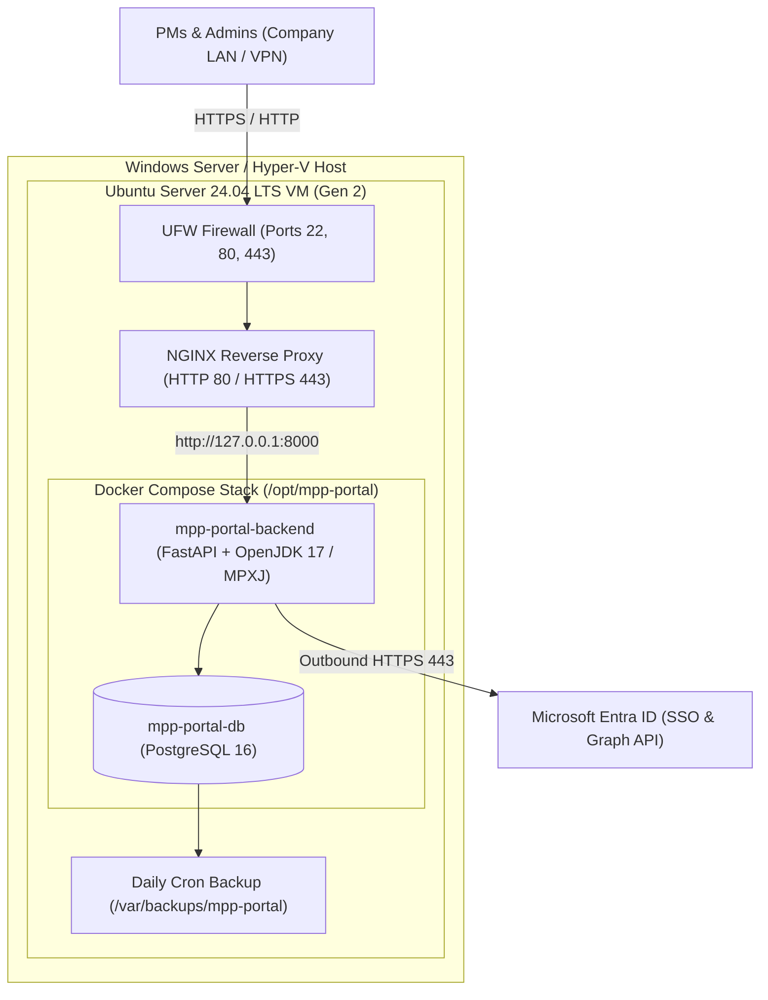

# Production Deployment Guide: Hyper-V Linux Virtual Machine (Ubuntu Server LTS)

This guide covers end-to-end deployment of the **MS Project Centralized Resource & Template Hub** on your local **Microsoft Hyper-V** infrastructure using an **Ubuntu Server 24.04 LTS (or 22.04 LTS)** virtual machine.

---

## 1. Architecture Overview (Hyper-V Linux VM)



### Recommended Hyper-V VM Specifications
| Resource | Recommended Specification | Notes |
|---|---|---|
| **OS** | **Ubuntu Server 24.04 LTS** (64-bit) | Minimal / Standard Server ISO |
| **VM Generation** | **Generation 2** (UEFI) | Enable Secure Boot with **Microsoft UEFI Certificate Authority** template |
| **vCPU** | **2 vCPUs** | 4 vCPUs if >30 concurrent PMs |
| **Memory (RAM)** | **4 GB Fixed RAM** | Covers PostgreSQL 16 + FastAPI + JVM/MPXJ parser |
| **Virtual Disk** | **40 GB Dynamic VHDX** | Stored on SSD/NVMe storage |
| **Network** | **External Virtual Switch** (Static LAN IP) | Needs LAN visibility for users + outbound port `443` to `*.microsoftonline.com` and `graph.microsoft.com` |

---

## 2. Step-by-Step Deployment

### Step 1: Create the VM on the Hyper-V Host (Automated PowerShell)
On your Windows Hyper-V Host, open **PowerShell as Administrator** and run the included [`deploy/Create-HyperV-LinuxVM.ps1`](deploy/Create-HyperV-LinuxVM.ps1) script:

```powershell
.\deploy\Create-HyperV-LinuxVM.ps1 `
    -VMName "MPP-Web-Portal-VM" `
    -SwitchName "Default Switch" `
    -IsoPath "C:\ISOs\ubuntu-24.04.1-live-server-amd64.iso" `
    -ProcessorCount 2 `
    -MemoryStartupBytes 4GB `
    -VHDSizeBytes 40GB
```
*(Or create the Generation 2 VM manually in **Hyper-V Manager**, making sure under **Settings → Security** to change the Secure Boot template to **Microsoft UEFI Certificate Authority** so Ubuntu boots cleanly).*

### Step 2: Install Ubuntu Server LTS
1. Start the VM and connect via Hyper-V Manager:
   ```powershell
   Start-VM -Name "MPP-Web-Portal-VM"
   vmconnect.exe localhost "MPP-Web-Portal-VM"
   ```
2. Complete the standard Ubuntu Server installation:
   - Assign a **Static IP** on your corporate LAN (e.g., `192.168.x.x` or `10.x.x.x`) and optionally an internal DNS record (e.g., `mpp.garantgroup.local` or `mpp.garantgroup.eu`).
   - Check **[x] Install OpenSSH server**.
   - Do **not** select Docker inside the Ubuntu Snap installer screen (our setup script installs the official Docker Engine apt package).

### Step 3: Run the One-Command Ubuntu Provisioning Script
SSH into your new Ubuntu VM and run the automated installer [`deploy/ubuntu-vm-install.sh`](deploy/ubuntu-vm-install.sh):

```bash
git clone https://github.com/UABGarantGroup/mpp-web-portal.git /tmp/mpp-setup
sudo bash /tmp/mpp-setup/deploy/ubuntu-vm-install.sh
```

What this script configures automatically:
1. Installs **Hyper-V Linux Integration Services** (`linux-cloud-tools-virtual`), **Docker Engine**, **Docker Compose v2**, **NGINX**, and **UFW Firewall**.
2. Clones the portal repository to `/opt/mpp-portal`.
3. Generates `/opt/mpp-portal/.env` (with `chmod 600` root-only permissions and auto-generated `SECRET_KEY` and `POSTGRES_PASSWORD`).
4. Configures **NGINX** on ports `80` and `443` with a `50 MB` upload limit for `.mpp` project schedules.
5. Installs the daily PostgreSQL backup job at `/etc/cron.daily/mpp-portal-backup` (saving compressed dumps to `/var/backups/mpp-portal/` with 30-day retention).
6. Builds and launches `mpp-portal-backend` and `mpp-portal-db` containers with `restart: unless-stopped`.

---

## 3. Configure `.env` Secrets & Microsoft Entra ID Redirect URI

### 1. Populate `/opt/mpp-portal/.env` on the Linux VM
Edit `/opt/mpp-portal/.env` on the VM (this file is strictly local and never committed to Git):
```bash
sudo nano /opt/mpp-portal/.env
```
Verify/update your values:
```env
ENVIRONMENT=production
SECRET_KEY=<auto-generated-hex-key>
POSTGRES_PASSWORD=<auto-generated-db-password>

# Mandatory Login & Emergency Onboarding User
AUTH_ENABLED=true
EMERGENCY_ADMIN_USERNAME=emergency_admin
EMERGENCY_ADMIN_PASSWORD=Your_Strong_Emergency_Password_Here!

# Microsoft Entra ID (Garant Group Tenant)
AZURE_AD_TENANT_ID=2a1c1726-b03a-4784-b174-ef74d5fd411c
AZURE_AD_CLIENT_ID=0541bc01-23e8-438a-88b7-7ca7f54d4850
AZURE_AD_CLIENT_SECRET=<your-azure-client-secret>
```
Restart the backend container to apply the `.env` changes:
```bash
cd /opt/mpp-portal
sudo docker compose restart backend
```

### 2. Add the VM URL to Azure App Registration Redirect URIs
In **Microsoft Entra admin center / Azure Portal**:
1. Go to **App registrations** $\rightarrow$ select your app $\rightarrow$ **Authentication**.
2. Under **Web** $\rightarrow$ **Redirect URIs**, add the URL of your Hyper-V VM:
   - `https://<vm-ip-or-domain>` (e.g. `https://mpp.garantgroup.eu` or `http://192.168.1.50`)
3. Click **Save**.

---

## 4. First Login & Admin Onboarding Workflow

1. Open `https://<vm-ip-or-domain>` in your browser.
2. The **Full-Screen Login Gate** is presented as the mandatory first step (no application data is accessible without signing in).
3. **First-Time Onboarding:**
   - Sign in using the **Emergency Onboarding User** (`emergency_admin` + password from `/opt/mpp-portal/.env`).
   - Open the **Portal Users & Access** tab $\rightarrow$ click **Grant User Access (Entra ID)** $\rightarrow$ add your Microsoft Entra ID account with the **Admin** role.
   - Click **Sign Out**.
4. **Standard Daily Login:**
   - Click **Sign In with Microsoft Entra ID (SSO)** to log in with your Garant Group Microsoft account.

---

## 5. Day-2 Operations, Updates & Backups

### Updating the Portal from GitHub (Automated)
Run the one-command upgrade script:
```bash
cd /opt/mpp-portal
# Upgrade current branch:
sudo bash deploy/upgrade.sh

# Or upgrade to a specific branch (e.g. main or feat/mssql-migration):
sudo bash deploy/upgrade.sh feat/mssql-migration
```

This automated script:
1. Creates a timestamped safety backup of `/opt/mpp-portal/.env`.
2. Fetches and pulls the latest code from GitHub.
3. Automatically selects the right Docker Compose configuration:
   - External MS SQL Server / Remote DB: `docker-compose.external-db.yml`
   - Bundled PostgreSQL: `docker-compose.yml`
4. Rebuilds and restarts the backend container with zero lingering cache.
5. Verifies backend container health (`/health` endpoint) and outputs container status.

### Manual Update (Alternative)
```bash
cd /opt/mpp-portal
sudo git pull origin main
sudo docker compose up -d --build
```
*(If using external MS SQL Server: `sudo docker compose -f docker-compose.external-db.yml up -d --build`)*

### Checking Logs & Container Status
```bash
cd /opt/mpp-portal
sudo docker compose ps
sudo docker compose logs -f backend
```

### Database Backup & Restore
- **Manual Backup Now (PostgreSQL):**
  ```bash
  sudo /etc/cron.daily/mpp-portal-backup
  ls -lh /var/backups/mpp-portal/
  ```
- **Restore from a Backup (PostgreSQL):**
  ```bash
  cd /opt/mpp-portal
  gunzip -c /var/backups/mpp-portal/mpp_hub_YYYYMMDD_HHMMSS.sql.gz | sudo docker compose exec -T db psql -U postgres -d mpp_hub
  ```
- **MS SQL Server Backups:**
  Managed directly via SQL Server Management Studio (SSMS) / SQL Server Agent maintenance plans on your database server host (`jupiteris.pg.dc`).

